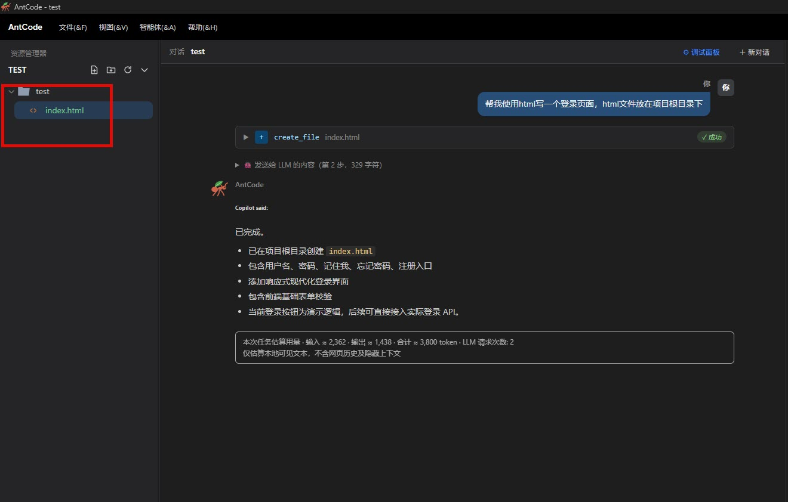
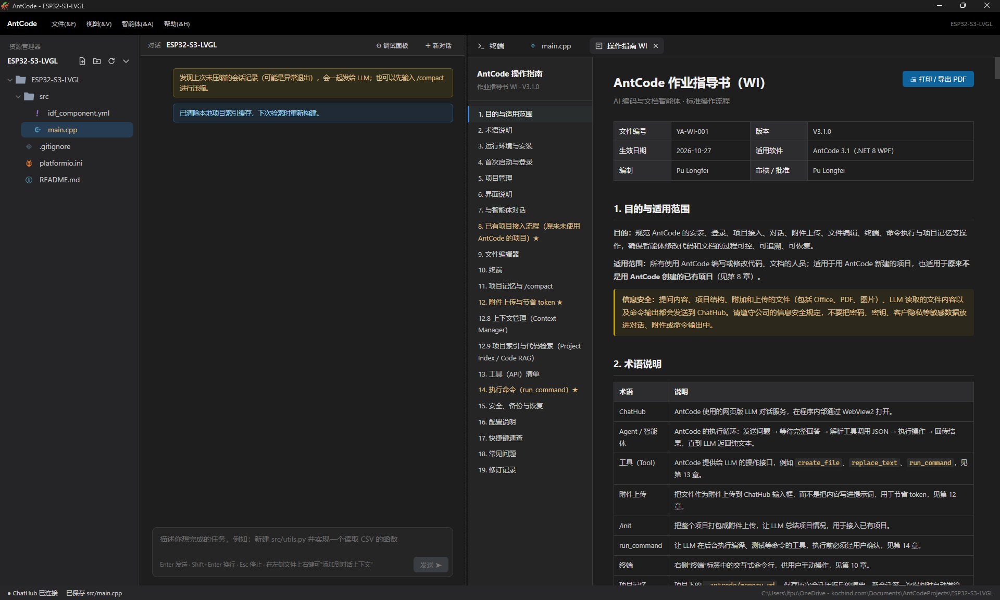

# AntCode

基于 .NET 8 WinForms + WebView2 的 Windows 桌面智能体。它用网页版 ChatHub（Copilot、DeepSeek）或 OpenAI 兼容 API 作为 LLM，在本地项目里新建、修改、删除文件，运行命令，帮你编写代码和文档。界面是 VS Code 风格的三栏布局，内置编辑器、终端和 Markdown 预览。

当前版本 2.1.0。操作指南（WI）在程序里按 F1 打开，有中文和英文两份；本文件是概览。

## AI to do



## 如何下载
在本仓库 Release 里面找到最新的exe下载安装即可。


## 使用前请先阅读操作说明：帮助-操作指南
## 功能一览

- **两种 LLM 后端**：ChatHub 网页（Copilot、DeepSeek）和 OpenAI 兼容 API（OpenAI、Azure、DeepSeek、通义、Ollama、vLLM、LM Studio 等），用 `LlmMode` 切换。
- **21 个工具**：17 个文件工具、`run_command`、`update_todos`、`submit_plan`、`use_skill`。
- **任务清单**：LLM 把多步任务拆成清单并逐项推进，清单还有未完成项时自动继续，不用再手动说「继续第 N 步」。
- **计划模式**：批准计划之前只读，不会写文件，也不会执行命令。
- **技能（Skills）**：兼容 Claude 的 `SKILL.md`，支持文件夹、zip 和 GitHub 地址导入。
- **项目记忆**：`/init` 生成，`/compact` 压缩，新对话自动带上。
- **省 token 设计**：工具说明只发一次，目录树只发变化，长文件转附件，工具结果精简。
- **右侧标签页**：Monaco 编辑器、终端、Markdown 预览、任务清单、技能、WI、ChatHub 调试视图。
- **强制自动更新**：从 GitHub Release 下载，校验 SHA-256 后静默安装。
- **中英文界面**：界面、提示词、工具消息和 WI 都跟随语言设置。

## 运行环境与构建

- Windows 10/11，已安装 Microsoft Edge WebView2 Runtime（Win11 自带）
- .NET 8 SDK，Visual Studio 2022 17.8 以上

```powershell
cd AntCode
dotnet restore
dotnet run
# 发布单文件 EXE
dotnet publish -c Release -r win-x64 --self-contained false -p:PublishSingleFile=true
```

- 发布后 Assets 文件夹需要与 AntCode.exe 放在同一目录（项目已设置自动复制）。
- 构建时会运行 `Tools/GenerateLanguageMap.ps1`，生成文件图标映射 `Assets/FileIcons/language-map.json`。不需要时加 `-p:GenerateFileIconLanguageMapOnBuild=false` 跳过。

## 使用流程

1. **更新检查**：Release 构建每次启动都先检查更新，详见下文「自动更新与发布」。
2. **授权**：弹出授权码窗口，输入授权码后继续。
3. **ChatHub 登录**（仅 ChatHub 模式，API 模式跳过）：WebView2 打开 `ChatUrl`，检测到聊天输入框后自动进入下一步，也可以手动点「我已登录，继续」。登录 Cookie 保存在 `%LocalAppData%\AntCode\WebView2`，下次启动会自动通过。
4. **项目选择页**：最近项目（可搜索、右键移除）、新建项目（名称 + 位置，在该位置下创建同名文件夹）、打开已有文件夹。
5. **主界面**：见下一节。

## 主界面

- **左侧**：资源管理器，文件和文件夹按扩展名显示 Seti 图标。
- **中间**：对话区。
- **右侧**：标签页，包括 Monaco 编辑器（双击文件打开，带文件图标）、终端（xterm + ConPTY，默认打开）、Markdown 预览、任务清单、技能、WI（F1）、ChatHub 调试视图（F12，API 模式下隐藏）。
- **菜单「智能体」**：删除前确认、计划模式、任务清单、技能管理、LLM 后端设置。

隐藏 ChatHub 视图时并不真正设为不可见，而是铺在对话面板下层，同时关闭 Chromium 后台节流，避免页面被挂起导致回答中断。

## LLM 后端

`settings.json` 里的 `LlmMode` 选择后端，修改后需要重启。两种后端都用「文本约束 + JSON 代码块」让 LLM 调用工具，没有用原生 function calling。

### ChatHub 模式（`chathub`，默认）

- `ChatUrl` 指向 Copilot 网页（默认 `https://copilot.cloud.microsoft/chat`）或 `https://chat.deepseek.com/`，程序会自动选择对应的页面脚本：Copilot 用 `Assets/bridge.js`，DeepSeek 用 `Assets/bridge.deepseek.js`。`ChatProvider` 可以强制指定：`auto` / `copilot` / `deepseek`。
- Copilot 页面的 DOM 选择器在 `Selectors` 里，页面改版时只改配置，不用重新编译。
- DeepSeek 只读最终回答，不读思考内容；选择器集中在 `bridge.deepseek.js` 开头的 `SEL`，改它同样不用重新编译。在 F12 控制台运行 `window.__yu.probe()` 可以检查各元素是否找到。
- DeepSeek 专用设置：`DeepSeekSearch`（联网搜索开关，默认 off）、`DeepSeekDeepThink`（深度思考开关，默认 keep）、`DeepSeekStableMilliseconds`（回答文本多久不变才算完成，默认 6000 毫秒）。

### API 模式（`api`）

- 走 OpenAI 兼容的 `/chat/completions`，默认流式输出。
- 菜单「智能体 → LLM 后端设置」里配置，带「测试连接」。
- `Api.ApiKey` 用 Windows DPAPI（当前用户）加密保存，在 settings.json 里是 `dpapi:` 开头的文本；留空时读环境变量 `ANTCODE_API_KEY`。旧版的明文 Key 需要在设置窗口重新保存才会转成加密。
- 附件：文本文件内联进消息；图片和 Office/PDF 暂不支持，会跳过并提示。
- 本地保存对话历史，超出 `Api.ContextChars`（默认 200000 字符）后裁剪较早的消息。

## 工作原理

```
用户输入 ─► PromptBuilder 组合：用户问题 + 项目信息 + 工具说明 + 回答规则
  ChatHub：写入输入框（paste 事件 ─► CDP Input.insertText ─► execCommand，三级兜底）
           ─► 点击发送按钮（找不到则用 CDP 发送回车）
           ─► 等待完整回答 ─► 取最后一条回答里的全部代码块
  API：    发送 chat-completions 请求 ─► 取回答文本里的 json 代码块
  ─► 逐个解析 JSON，按顺序执行工具
  ─► 把执行结果回传给 LLM，循环，直到 LLM 返回纯文本 ─► 显示在对话区
```

单个任务最多执行 `MaxAgentSteps` 轮（默认 15）。

### 如何确保拿到完整回答（ChatHub）

- 发送前记录回答数量和最后一条回答的哈希值。
- 阶段 1：等待出现新回答（数量增加或内容变化），超时为 `FirstTokenTimeoutSeconds`。
- 阶段 2：页面上没有「停止生成」按钮，并且回答文本连续 `StableMilliseconds` 毫秒不变，才算完成。
- 代码块看起来像工具 JSON 但还解析不了时，最多再等 4 个稳定周期。
- 总超时为 `ResponseTimeoutSeconds`，到时使用已获取的内容并给出提示。

### 解析与容错

- 工具名、参数名支持常见别名（如 `create_new_file`、`fileName`）。
- 支持单个对象、对象数组、`tool_calls` 包装和 OpenAI function 写法。
- 自动修复 JSON 字符串中未转义的换行；仍无法解析时把错误回传给 LLM 重新输出。
- 工具说明每个对话只发一次，之后只附一行简短提醒。

## 工具列表

| 工具 | 参数 | 说明 |
|---|---|---|
| create_file | path, content, overwrite? | 新建文件 |
| write_file | path, content | 覆盖写入整个文件（不存在则创建） |
| append_to_file | path, content | 追加到末尾 |
| read_file | path, startLine?, endLine? | 读取带行号的内容；较长时整个文件作为 .md 附件提供。ChatHub 模式下也可读 PDF、Word、Excel、PPT 和图片（只读） |
| replace_lines | path, startLine, endLine, content | 替换第 N 到 M 行（含两端） |
| insert_lines | path, line, content | 在第 line 行之前插入（line 等于总行数加 1 表示追加） |
| delete_lines | path, startLine, endLine | 删除第 N 到 M 行 |
| replace_text | path, oldText, newText, replaceAll? | 精确文本替换，优先使用 |
| delete_file | path | 删除文件（可确认，自动备份） |
| move_file | path, newPath, overwrite? | 移动或重命名文件 |
| copy_file | path, newPath | 复制文件 |
| create_folder | path | 新建文件夹（支持多级） |
| delete_folder | path, recursive? | 删除文件夹（可确认，自动备份） |
| move_folder | path, newPath | 移动或重命名文件夹 |
| list_directory | path, recursive?, maxDepth? | 列出目录 |
| search_text | query, path?, filePattern?, isRegex? | 在文件中搜索（path 要写目录，用 filePattern 限定文件名） |
| get_file_info | path | 获取文件或文件夹信息 |
| run_command | command, cwd?, timeoutSeconds?, reason | 执行命令行（非交互），执行前需要你确认 |
| update_todos | todos（每项 content, status, note?） | 维护任务清单，每次传入完整清单，覆盖旧清单 |
| submit_plan | plan | 提交计划并等待你批准（计划模式下使用） |
| use_skill | name | 加载一个技能的完整指令 |

- 路径限制在项目目录内；修改、删除前备份到 `%LocalAppData%\AntCode\backups`；修改文件时保留原编码（BOM）和换行符（CRLF/LF）。
- 唯一的例外是技能文件夹：`read_file` 可以只读访问它（见「技能」）。

### run_command

- 在后台无窗口运行，不能交互输入，不要用来启动长期运行的程序。
- 每次执行前弹出确认，高风险命令标红；`BlockedCommandPatterns` 里的命令（格式化磁盘、`shutdown`、递归删除根目录等）直接拒绝。
- `AutoApproveCommands` 里的前缀（例如 `dotnet build`、`git status`）免确认，但高风险或带串联符号的命令仍需确认。
- Shell 由 `CommandShell` 决定（`powershell` / `pwsh` / `cmd`），默认超时 `CommandTimeoutSeconds`（300 秒），上限 `MaxCommandTimeoutSeconds`（1800 秒），`AllowRunCommand` 可以整体关闭。
- 成功时只把警告、错误和最后 `CommandSuccessTailLines`（20）行回传给 LLM，失败时回传完整输出。

## 斜杠命令

| 命令 | 作用 |
|---|---|
| `/init` | 把整个项目打包成附件，让 LLM 总结并生成项目记忆 |
| `/compact` | 让 LLM 压缩当前会话，合并进项目记忆 |
| `/plan` | 开关计划模式 |
| `/技能名 任务描述` | 直接调用某个技能，把它的指令附在这条消息里 |

## 任务清单

预计需要 3 步以上的任务，LLM 会先调用 `update_todos` 列出计划，开始某步前标记 `in_progress`，完成后标记 `completed`。

- 清单按项目保存在 `.antcode/todos.json`，每次传入完整清单，覆盖旧清单。
- 最多 12 项，状态为 `pending` / `in_progress` / `completed` / `blocked`，同一时间只允许一个 `in_progress`；不符合时工具返回错误，LLM 会自动修正。
- 菜单「智能体 → 任务清单」打开右侧「任务清单」标签页，清单出现时也会自动打开。双击编辑，右键改状态、上移、下移、删除，底部可以添加、清空，还有「计划模式」复选框。
- 你手动改过清单后，下一条消息会把最新清单告诉 LLM，以你的修改为准。
- 重开项目或新建对话后，未完成的清单会随第一条消息发给 LLM，可以接着做。

### 自动继续

LLM 用纯文本结束回答，但清单里还有未完成项时，AntCode 自动发送「继续」。

- `TodoAutoContinue`：`pending`（默认，有未完成项时继续）/ `off`。
- `TodoMaxAutoContinues`：一次用户请求内最多自动继续的次数，默认 8。
- 以下情况不会自动继续：回答以问号结尾、有任务被标为 `blocked`、两次之间清单没有任何变化、达到次数上限、你按了停止、处于计划模式。

## 计划模式

菜单「智能体 → 计划模式」、任务清单标签页底部的复选框，或输入 `/plan` 开关，状态栏显示「● 计划模式」。

- 开启后，LLM 只能使用 `read_file`、`list_directory`、`search_text`、`get_file_info`、`update_todos`、`use_skill` 和 `submit_plan`；写入、删除、移动文件和 `run_command` 一律拒绝。
- LLM 探索完成后调用 `submit_plan` 提交计划，弹出「审批计划」窗口：
  - 「批准并执行」：退出计划模式，LLM 开始修改。
  - 「要求修改」：把你写的意见发给 LLM，让它修改计划后重新提交。

## 技能（Skills）

技能是一个文件夹，必须有 `SKILL.md`：顶部是 frontmatter（`name` 和 `description`），后面是详细指令，还可以带脚本、模板和参考文档。格式兼容 Claude 的技能，现成的技能可以直接使用。

### 存放与管理

- 全局目录：`%AppData%\AntCode\skills\技能名\`，所有项目共用。
- 菜单「智能体 → 技能管理」打开右侧「技能」标签页：勾选框启用或禁用，双击打开 `SKILL.md`，右键删除，底部按钮：
  - **导入文件夹**
  - **导入 zip**（拒绝不安全的路径）
  - **从 GitHub 导入**
  - **打开目录**
  - **刷新**
- 也可以直接把技能文件夹放进技能目录，再点「刷新」。
- 安装时会提示「技能是别人写的指令，只安装信任的来源」，含脚本时再单独提示一次，重名时询问是否覆盖。

### 从 GitHub 导入

支持这些地址：

- 仓库：`https://github.com/owner/repo`
- 仓库里的文件夹：`https://github.com/owner/repo/tree/main/skills/xxx`
- `SKILL.md` 文件链接（包括 `raw.githubusercontent.com`）
- 简写：`owner/repo`

流程与限制：

- 下载仓库 zip，只在给定路径下查找含 `SKILL.md` 的文件夹；找到多个时弹出窗口勾选。
- 只允许 github.com 系列域名，重定向逐跳检查；只支持公开仓库，不需要安装 git。
- 压缩包最大 80 MB，下载超时 120 秒，可随时取消。

### 校验规则

| 项 | 规则 |
|---|---|
| name | 小写字母、数字和连字符，最长 64 个字符，必须与文件夹名一致，不能是 `init`、`compact`、`plan` |
| description | 必填，最长 1024 个字符；发给 LLM 的目录里截断到约 200 个字符，所以要把「什么时候该用」写在前面 |
| 大小 | 每个技能最多 300 个文件、10 MB |

### 使用方式

- **LLM 自选**：对话开始时只发已启用技能的名称和简短描述（技能有变化时重发一次）；任务匹配某个描述时，LLM 调用 `use_skill` 加载完整指令，同一对话不重复加载，较长的指令以附件形式送达。
- **手动调用**：`/技能名 任务描述` 直接把该技能的指令附在这条消息里。网页版 LLM 有时会忽略技能目录，这种方式更可靠。
- **文件和脚本**：`read_file` 可以只读访问技能文件夹（写绝对路径，或 `skill:技能名/相对路径`）；技能自带的脚本用 `run_command` 执行，每次都弹确认，确认框标注「来源技能」，禁止规则继续生效。
- **计划模式**：`use_skill` 在计划模式下可用，但技能里要求的写入和命令仍被拒绝。
- **工具名对应**：Claude 技能里的 Bash、Read、Write、Edit，对应这里的 `run_command`、`read_file`、`write_file`、`replace_text`。
- 设置：`DisabledSkills`（被禁用的技能文件夹名，在标签页里勾选即可，不需要手改）、`MaxEnabledSkills`（默认 30，目录里最多列出的已启用技能数）。
- 示例：`Assets/skill-examples/commit-message` 是一个现成的示例技能（根据当前改动写 Git 提交说明），用「导入文件夹」试用。

## 项目记忆与省 token

项目级数据保存在项目的 `.antcode/` 目录：

| 文件 | 作用 |
|---|---|
| `memory.md` | 长期项目记忆 |
| `history.jsonl` | 会话历史 |
| `session_pending.jsonl` | 尚未压缩的会话记录 |
| `todos.json` | 任务清单 |

- `/init`：把整个项目打包成附件，让 LLM 总结并生成记忆。
- `/compact`：让 LLM 压缩当前会话，合并进 `memory.md`。退出或切换项目时也会自动压缩（`AutoCompactOnExit`）。
- 新对话第一次提问时注入记忆，而不是每条消息都重复发送。

省 token 的做法：

- 工具说明每个对话只发一次，之后只附一行提醒（`AlwaysSendToolSpec` 可改成每次都发）。
- 项目目录树首条发完整，之后只发增删（`ProjectTreeMode`：`diff` / `once` / `always`）。
- 文本文件打包成 `.md` 附件上传；`read_file` 结果达到 `ReadFileUploadMinChars`（3000 字符）时转成附件。
- 修改类工具成功后只回一行结果（`EditResultPreview`），`run_command` 成功时只回警告、错误和最后几行。
- ChatHub 模式下 Office、PDF 和图片按原文件上传，单个最大 20 MB，每个对话最多 18 个附件。

## 配置文件 %AppData%\AntCode\settings.json

部分字段可以在菜单里改，也可以直接编辑 settings.json，保存后程序会自动重新加载（改 `LlmMode`、`Language` 需要重启）。

| 字段 | 默认值 | 说明 |
|---|---|---|
| `LlmMode` | `chathub` | LLM 后端：`chathub` / `api` |
| `ChatUrl` | Copilot 聊天地址 | ChatHub 地址；填 `https://chat.deepseek.com/` 自动切换到 DeepSeek |
| `ChatProvider` | `auto` | ChatHub 页面类型：`auto` / `copilot` / `deepseek` |
| `Api` | | API 模式的地址、模型、Key、认证方式、温度、流式、上下文字符预算、系统提示词、额外请求头 |
| `DeepSeekSearch` / `DeepSeekDeepThink` | `off` / `keep` | DeepSeek 页面的联网搜索和深度思考开关 |
| `DeepSeekStableMilliseconds` | 6000 | DeepSeek 回答多久不变才算完成 |
| `Language` | `auto` | 界面语言：`auto` / `zh-CN` / `en-US` |
| `ShowDebugView` | false | 是否显示右侧 ChatHub 调试视图 |
| `AutoContinue` | true | 工具执行后是否自动把结果回传给 LLM |
| `ConfirmDestructive` | true | 删除前是否弹窗确认 |
| `MaxAgentSteps` | 15 | 单个任务最多执行多少轮 |
| `TodoAutoContinue` | `pending` | 任务清单还有未完成项时是否自动继续：`pending` / `off` |
| `TodoMaxAutoContinues` | 8 | 按清单自动继续的最大次数 |
| `DisabledSkills` | 空 | 被禁用的技能文件夹名 |
| `MaxEnabledSkills` | 30 | 目录里最多列出的已启用技能数 |
| `StableMilliseconds` / `PollIntervalMilliseconds` | 3500 / 500 | ChatHub 判断回答完成的稳定时长 / 轮询间隔 |
| `FirstTokenTimeoutSeconds` / `ResponseTimeoutSeconds` | 120 / 900 | ChatHub 超时设置 |
| `AllowRunCommand` | true | 是否允许 LLM 调用 `run_command` |
| `CommandShell` | `powershell` | `run_command` 使用的 Shell：`powershell` / `pwsh` / `cmd` |
| `CommandTimeoutSeconds` / `MaxCommandTimeoutSeconds` | 300 / 1800 | 命令默认超时 / 上限 |
| `AutoApproveCommands` | 空 | 无需确认的命令前缀 |
| `BlockedCommandPatterns` | 内置一组 | 直接拒绝的命令（正则，忽略大小写） |
| `TerminalShell` | `powershell.exe -NoLogo` | 终端使用的 Shell |
| `OpenTerminalOnStart` | true | 启动时是否打开终端标签 |
| `ProjectTreeMode` | `diff` | 目录树发送方式：`diff` / `once` / `always` |
| `MaxTreeEntries` / `MaxTreeDiffEntries` | 350 / 80 | 目录树条目上限 / diff 超过此数改发完整树 |
| `EditResultPreview` | `none` | 修改类工具成功后是否回传改动预览：`none` / `full` |
| `ReadFileAsUpload` / `ReadFileUploadMinChars` | true / 3000 | `read_file` 长内容转附件 |
| `MaxUploadsPerConversation` | 18 | 单个 ChatHub 对话最多上传的附件数 |
| `UploadExtensions` / `RawUploadExtensions` | 内置一组 | 打包为 .md 的扩展名 / 以原文件上传的扩展名 |
| `AutoCompactOnExit` | true | 退出或切换项目时自动压缩会话记忆 |
| `Selectors` | 内置 | Copilot 页面 DOM 选择器，页面改版时只改这里 |
| `IgnoredFolders` | 内置一组 | 文件树和工具中忽略的目录 |

## 自动更新与发布

### 自动更新

- Release 构建每次启动先检查更新，有新版本或检查失败都不能使用，只有「重试」和「退出」。Debug 构建默认跳过，设置环境变量 `ANTCODE_FORCE_UPDATE_CHECK=1` 可以测试。
- 通过 GitHub 公开 API 找 tag 为 `AntCodeSetup_x.x.x.x` 的最高正式版；被限流时改读 `/releases/latest` 的跳转。
- 发布里必须同时有 `.exe` 和名称含 `sha256` 的哈希附件；下载后校验 SHA-256，通过后以 `/SILENT /CLOSEAPPLICATIONS` 安装并重启。安装包不做签名，只校验哈希。

### 发布

- 安装包由 `antcode.iss`（Inno Setup）生成；`AppId` 固定，`AppMutex` 与 `UpdateService.MutexName` 保持一致。
- 根目录的 `Publish-Release.ps1` 用 GitHub CLI（`gh`）先建草稿，确认两个附件后再公开发布。使用前需要安装 `gh` 并执行 `gh auth login`。
- 发布前确认安装包里带上了 `Assets` 文件夹（含 `bridge.deepseek.js` 和 `skill-examples`）。

## 项目结构

```
AntCode/
├─ Program.cs                 启动顺序：更新检查 → 授权 → 登录 → 项目选择 → 主界面
├─ Core/
│  ├─ AgentOrchestrator.cs    主循环、工具调度、任务清单、计划模式、技能
│  ├─ PromptBuilder.cs        提示词、目录树、附件
│  ├─ ToolCallParser.cs       解析 LLM 返回的工具调用 JSON
│  ├─ FileToolExecutor.cs     文件工具、别名、技能只读路径
│  ├─ CommandTool.cs / CommandRunner.cs   run_command
│  ├─ Todo.cs / TodoTool.cs   任务清单
│  ├─ PlanMode.cs             计划模式的允许列表和审批决定
│  ├─ Skills.cs / SkillTool.cs / SkillInstaller.cs / GitHubSkillSource.cs   技能
│  ├─ SessionMemory.cs        会话历史和项目记忆
│  ├─ ProjectPacker.cs        项目打包和附件
│  ├─ ChatHubBridge.cs / ChatSite.cs   ChatHub 桥接与站点识别
│  ├─ Llm/                    API 后端、OpenAI 兼容请求、密钥存储
│  ├─ AppSettings.cs / I18n.cs
│  ├─ UpdateService.cs / LicenseService.cs
│  └─ FileIconTheme.cs / SetiFontManager.cs   文件图标
├─ UI/
│  ├─ MainForm.cs             主界面、菜单、标签页、斜杠命令
│  ├─ TodoPanel.cs / SkillsPanel.cs / PlanApprovalForm.cs / GitHubImportDialogs.cs
│  ├─ ExplorerView.cs / EditorHost.cs / EditorTabStrip.cs / TerminalHost.cs / MarkdownPreviewHost.cs
│  ├─ ChatView.cs / ApiSettingsForm.cs / UpdateForm.cs 等
│  └─ Theme.cs
├─ Assets/
│  ├─ chat.html / editor.html / preview.html / terminal.html
│  ├─ bridge.js / bridge.deepseek.js
│  ├─ wi.html / wi.en.html    操作指南（中文 / 英文）
│  ├─ i18n/                   界面文字（zh-CN.json、en-US.json）和提示词（prompts/）
│  ├─ skill-examples/         示例技能
│  ├─ FileIcons/              Seti 字体、图标主题、language-map.json
│  └─ monaco/                 Monaco 编辑器
└─ Tools/GenerateLanguageMap.ps1
```

## 开发约定

- 修改后用 `dotnet build -o ..\_buildcheck --nologo -v q` 验证，完成后删除 `_buildcheck`。
- 新增界面文字必须同时改 `zh-CN.json` 和 `en-US.json`；中英文提示词和 WI 要同步。
- 工具名、JSON 参数名和协议标记不翻译。
- 新功能不能破坏现有的 Copilot ChatHub；涉及 ChatHub 时同时兼顾 DeepSeek。
- 大文件分批写入，避免单次 JSON 过长而解析失败。

## 注意事项

- **ChatHub 页面改版**：Copilot 改版时改 `Selectors`，DeepSeek 改 `bridge.deepseek.js` 开头的 `SEL`，都不需要重新编译。
- **登录状态**：Cookie 保存在 `%LocalAppData%\AntCode\WebView2`，删除该文件夹即可退出登录。
- **隐私**：分享页面 DOM 之前，先去掉手机号、邮箱等个人信息。
- **技能是别人写的指令**：只安装信任的来源；技能脚本不会自动运行，每次执行前都会弹出确认。
